# agent-office

**Walk through your AI agents like an office.** agent-office is a desktop app (macOS, Windows,
Linux) that shows every running AI agent as a worker in a 3D office:

- Agents are grouped into **wings by provider** and **desk pods by conversation topic**.
- Where an agent is tells you what it is doing: working at its desk, in a meeting with its
  subagents, waiting for you in a phone booth, on a coffee break, at a station in the Adapters
  room, or reading in the Library.
- You can **message them** without leaving the app.

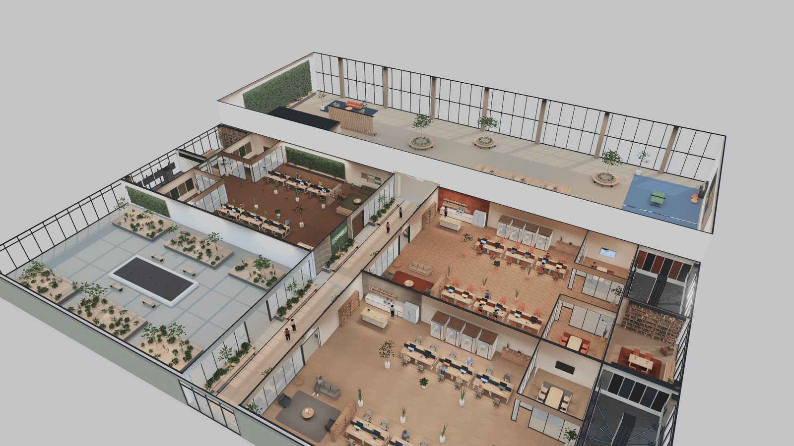

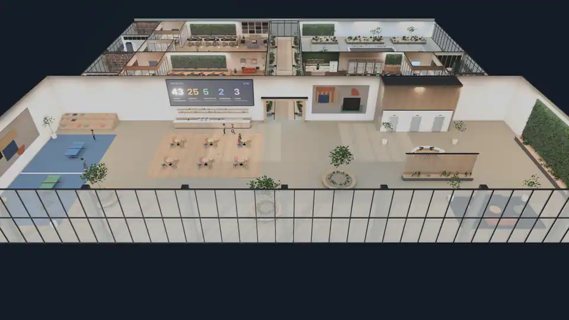

## Connect your agents

Open the app. If the office is empty, a card offers three ways in. The **🔌 Connect** button (next to ⚙) shows the same choices at any time, with live status for each:

| Way in            | What you do                                                                                                                                                                              | You'll see                                                                                                                    |
| ----------------- | ---------------------------------------------------------------------------------------------------------------------------------------------------------------------------------------- | ----------------------------------------------------------------------------------------------------------------------------- |
| **Claude Code**   | Nothing: run `claude` in any project. To message sessions from the app, click **Install** under "Let me message agents".                                                                 | "● 1 active session". The agent walks in through the elevator to the `claude-code` wing.                                      |
| **Any framework** | Copy the ready-made curl, Python or JavaScript snippet from **Connect → Any framework** into your agent. It already has the right port and reads the token from `~/.agent-office/token`. | "✓ Received from `<provider>`". The provider's wing appears. **Send a test agent** checks the whole path from inside the app. |
| **Demo**          | **Try the demo**                                                                                                                                                                         | 9 sample agents across 3 providers, to explore the rooms, links and chat                                                      |

<table><tr>
<td>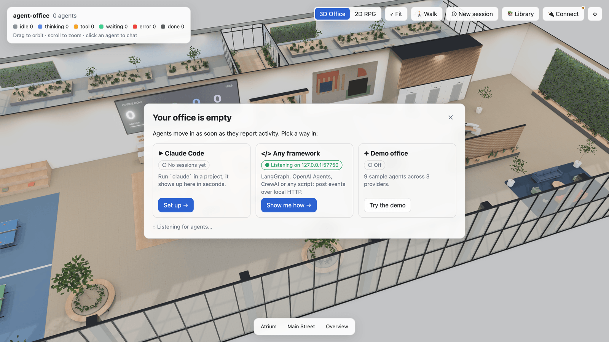</td>
<td>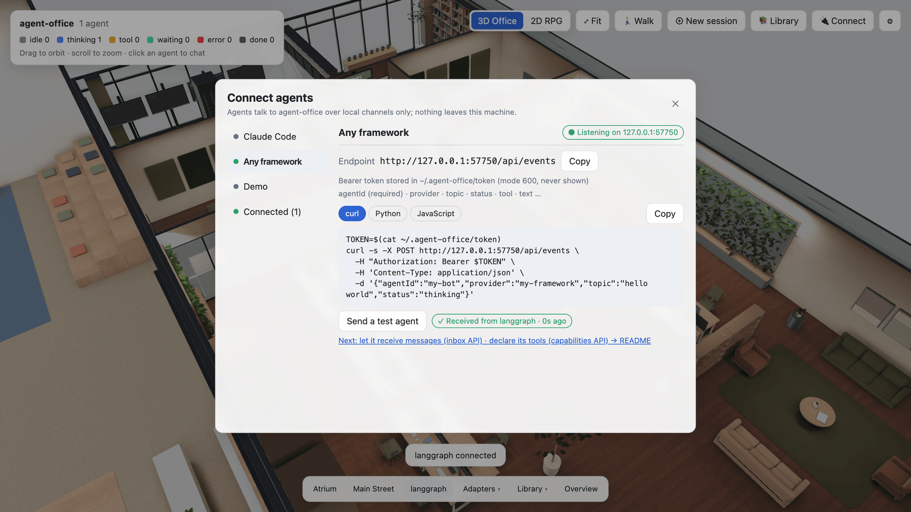</td>
</tr></table>

The **Connected** tab lists every provider, its agent count and how it's connected (transcripts, hook, HTTP or demo), with a button to fly to its wing. If port 4317 is taken, the Any framework tab says so and lets you pick another port. The Claude Code hook follows the new port automatically.

## Features

- **Live 3D office.** Claude Code, OpenAI Agents, LangGraph or your own framework each get a themed wing of a headquarters building. Every topic gets a desk pod, and agents walk to meeting rooms, phone booths, the kitchen and the game area to act out what they are doing ([Tour](#tour)).
- **Managed sessions.** Start Claude Code from the app and switch its permission mode and model live, approve tool calls from permission cards, interrupt or stop it ([Managed sessions](#managed-sessions)).
- **Context and tools in every message.** Attach files and folders, and ask the agent to use the Chrome browser, an MCP server or a skill ([Talk to agents](#talk-to-agents)).
- **2D RPG mode (optional).** The same live office as a top-down, GBA-style pixel-art world you can walk around; talk to agents with E ([2D RPG mode](#2d-rpg-mode-optional)).
- **Light and dark themes.** System, Light or Dark, with the same features in both ([Appearance](#appearance)).
- **Chat with agents.** Messages go into a per-agent inbox. Claude Code sessions receive them through an opt-in hook, and any other agent can long-poll the inbox over HTTP ([Talk to agents](#talk-to-agents)).
- **Adapters room.** Every wing shows what its agents can reach (filesystem, shell, web, subagents, MCP servers, APIs, databases) as stations. Tool calls draw live links to them; sustained use sends the agent there ([Adapters](#adapters)).
- **Library.** Browse every skill, rule and memory entry from 📚, or fly to them in the office. Skills are books on the shelves, rules are boards on the wall and memory entries are notebooks. They glow when an agent consults them, and agents go and read when they use several ([Library](#library)).
- **Tray and notifications.** The app keeps running in the tray or menu bar, with live counts. You get a native notification when an agent starts waiting for you, replies, or hits an error ([Tray and notifications](#tray-and-notifications)).
- **Obvious setup.** An empty office shows how to connect Claude Code, any framework or a demo; the 🔌 Connect panel has live status, copy-ready snippets and a test button ([Connect your agents](#connect-your-agents)).
- **Zero-config Claude Code.** Running sessions, their subagents, configured MCP servers, skills and rules appear automatically ([Using it with Claude Code](#using-it-with-claude-code)).
- **Any agent framework.** A local HTTP API takes status events, capability declarations and chat replies ([Adapters](#adapters), [HTTP API](#http-api-for-any-agent-framework)).
- **Walk mode.** First-person WASD through the office. Press `E` to talk to the agent you're looking at ([Walk mode](#walk-mode)).
- **One-click hook setup and auto-update** from Settings, with a backup of your Claude Code settings ([Settings](#settings)).
- **Graphics presets** from Low to Ultra, with an Auto mode that keeps the frame rate smooth ([Graphics](#graphics)).
- **Hand-made characters** with 22 animation clips, built in Blender by committed scripts ([Characters](#characters)).

## Tour

The office is one floor of a big-tech-style headquarters. Where an agent is tells you what it is
doing. Name tags and the chat panel say it in words too, for example "In meeting room A with 2
subagents" or "Waiting for you in booth 3".

### Atrium

<table>
<tr>
<td width="50%">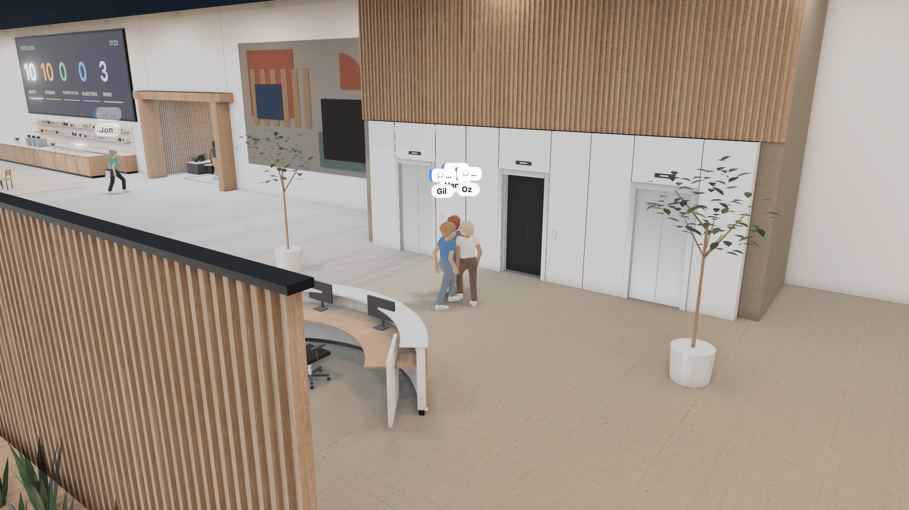</td>
<td width="50%">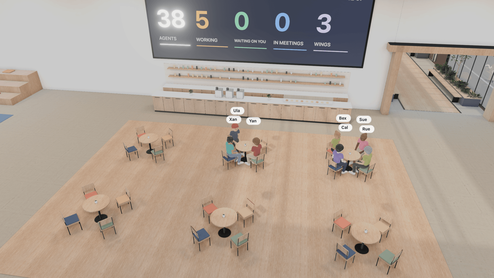</td>
</tr>
<tr>
<td>New agents step out of the elevators and check in at reception.</td>
<td>Idle agents take a coffee at the cafe; the LED wall counts agents, work, waits and meetings live.</td>
</tr>
</table>

### Main Street

<table>
<tr>
<td width="50%">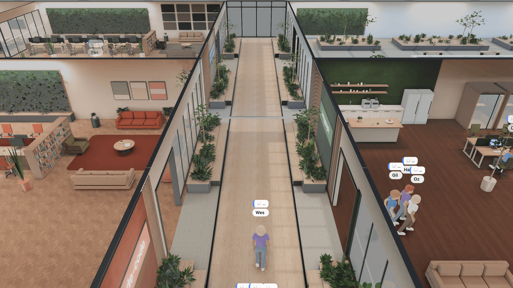</td>
<td width="50%">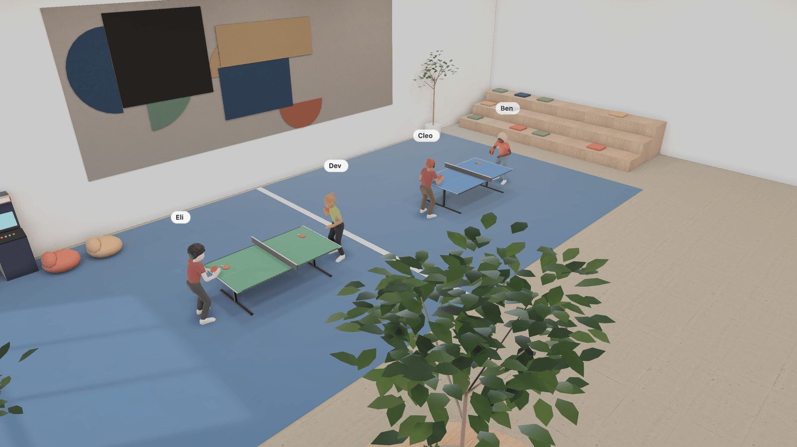</td>
</tr>
<tr>
<td>The boulevard between the wings: agents walk it on their way in, out and to breaks.</td>
<td>The game area: two agents on a long idle break pair up for ping-pong.</td>
</tr>
</table>

### Wings and themes

<table>
<tr>
<td width="50%">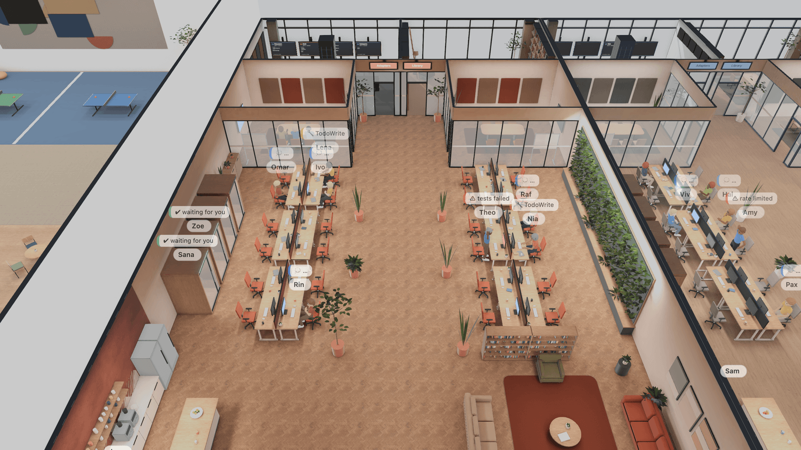</td>
<td width="50%">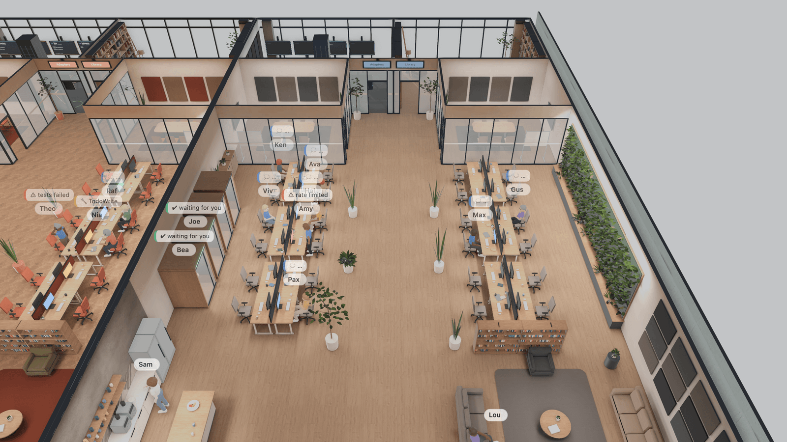</td>
</tr>
<tr>
<td><code>claude-code</code> (terracotta): desk pods by topic, booths, meeting rooms, kitchen and lounge.</td>
<td><code>openai-agents</code> (nordic). A provider with more than 24 agents gets an annex wing.</td>
</tr>
<tr>
<td width="50%">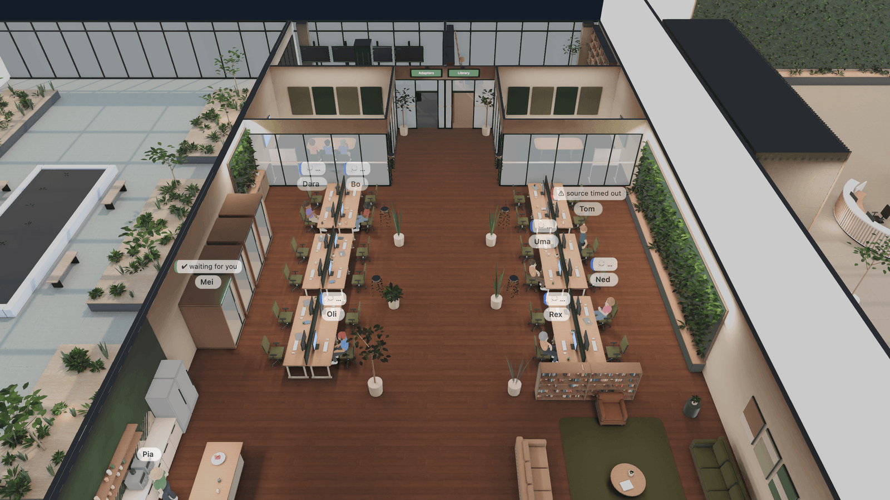</td>
<td width="50%">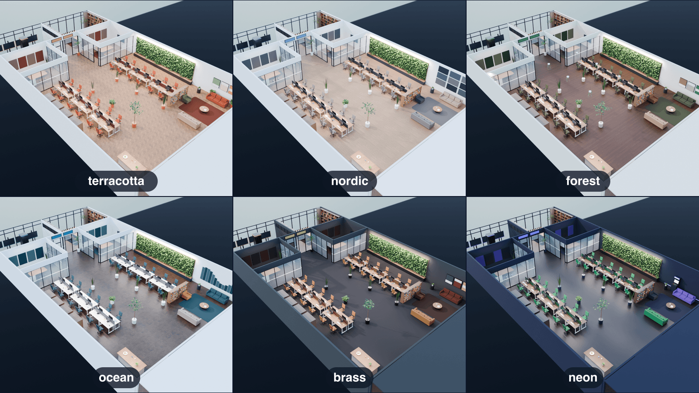</td>
</tr>
<tr>
<td><code>langgraph</code> (forest). Wing signs show the provider id as plain text.</td>
<td>All six themes: terracotta, nordic, forest, ocean, brass and neon.</td>
</tr>
</table>

### Desks

<table>
<tr>
<td width="50%">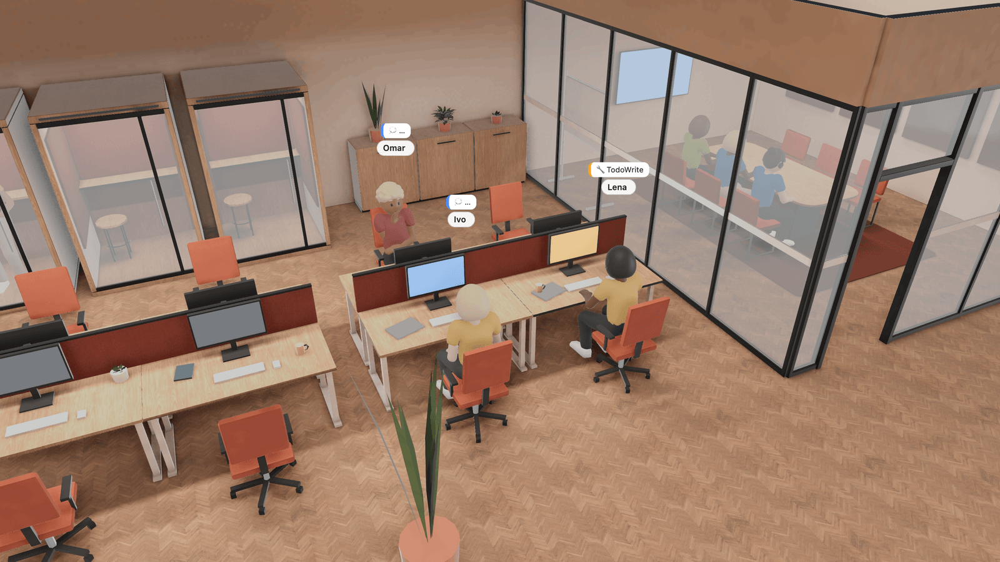</td>
<td width="50%">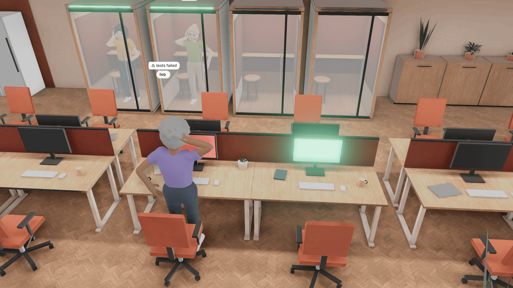</td>
</tr>
<tr>
<td>One pod per topic: agents type (amber monitor, running a tool) or think (blue).</td>
<td>An agent that hit an error stands up and scratches its head at a red monitor.</td>
</tr>
</table>

### Meeting rooms

<table>
<tr>
<td width="50%">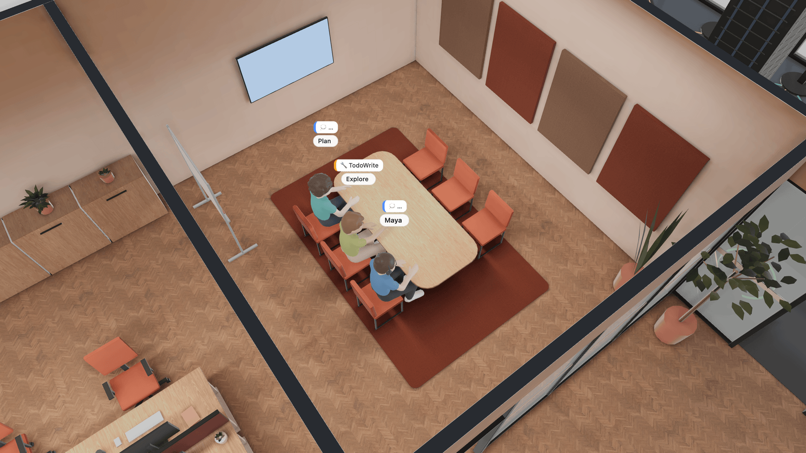</td>
<td width="50%">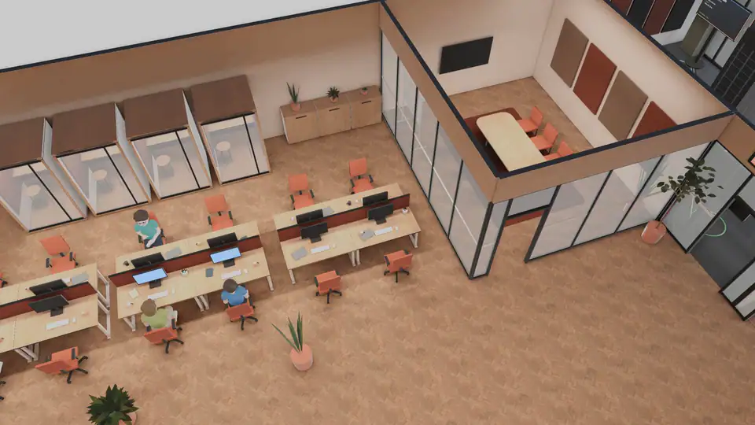</td>
</tr>
<tr>
<td>A parent agent and its active subagents work as a team in meeting room A or B.</td>
<td>When subagents spawn, the team gets up and walks into a free meeting room.</td>
</tr>
</table>

### Phone booths

<table>
<tr>
<td width="50%">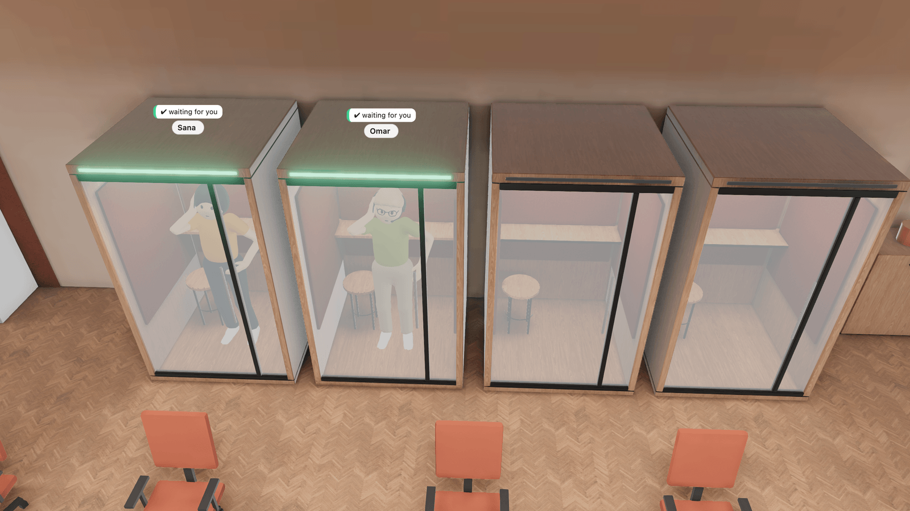</td>
<td width="50%">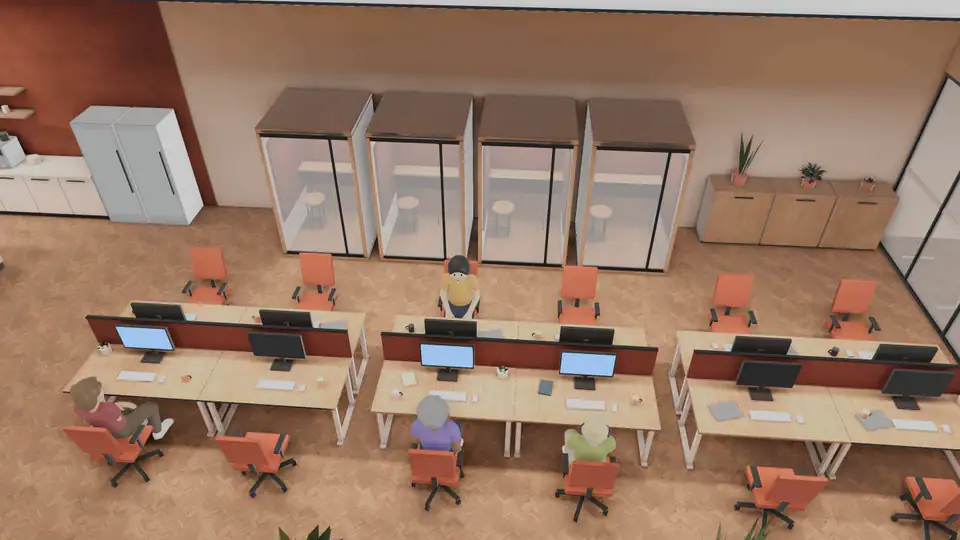</td>
</tr>
<tr>
<td>A green booth light means the agent finished its turn and is <strong>waiting for you</strong>.</td>
<td>The moment an agent starts waiting, it walks to a free booth. Click it to reply.</td>
</tr>
</table>

### Kitchen and lounge

<table>
<tr>
<td width="50%">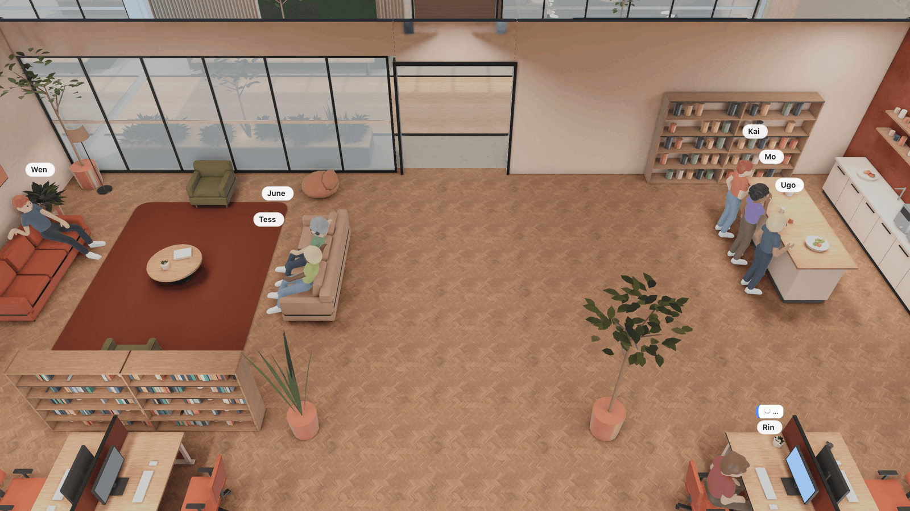</td>
<td width="50%"></td>
</tr>
<tr>
<td>After 45 seconds idle, agents take a break in the kitchen or on the lounge sofas…</td>
<td>…or at the atrium cafe. Pairs on a long break go to ping-pong.</td>
</tr>
</table>

### Arrival and leaving

<table>
<tr>
<td width="50%">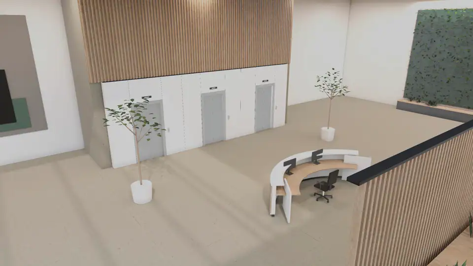</td>
<td width="50%"></td>
</tr>
<tr>
<td>New agents arrive through the elevators, check in and walk to their wing.</td>
<td>Finished (<code>done</code>) agents walk back to the elevators and leave.</td>
</tr>
</table>

## Talk to agents

Click an agent (or its name tag) to open the chat panel: the camera follows it, the panel says
what it is doing, and you can send it a message. Delivery state shows as ✓ (delivered to the
agent) and ✓✓ (replied).

<table>
<tr>
<td width="50%">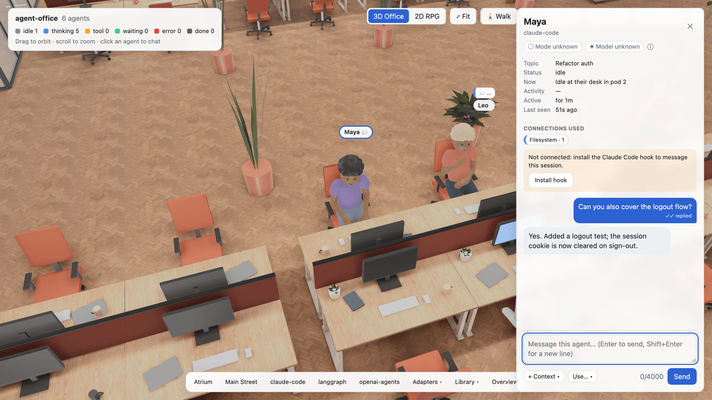</td>
<td width="50%">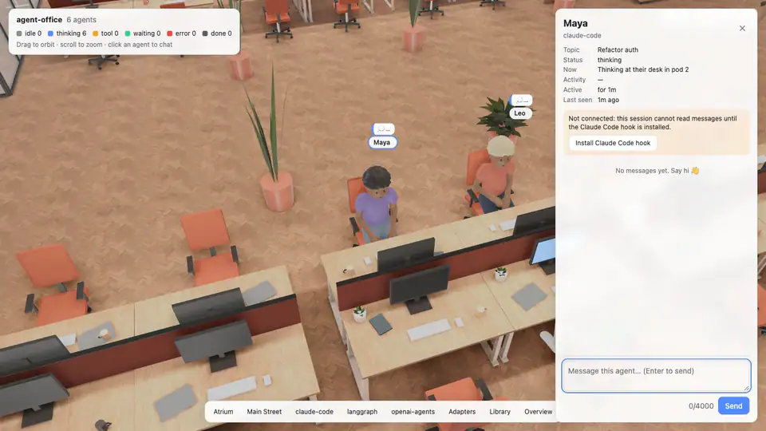</td>
</tr>
<tr>
<td>The chat panel: activity, model, connections and skills used, and the thread.</td>
<td>A round trip: the hook hands Claude the message when its turn ends and posts the answer back.</td>
</tr>
</table>

**Delivery hint.** The panel says exactly how a message will reach the agent:

| Agent                                                   | Hint                                                                                    |
| ------------------------------------------------------- | --------------------------------------------------------------------------------------- |
| Claude Code, hook not installed                         | "Not connected: install the Claude Code hook…" with **Install hook**                    |
| Claude Code, hook installed, session not checked in yet | "Hook installed ✓ · This session checks in after its current turn or your next prompt." |
| Claude Code, connected                                  | When the message is delivered (end of the current turn, or your next prompt)            |
| Subagent                                                | "Subagents can't read messages. Message its parent instead." with **Open parent**       |
| Managed session                                         | None: messages go straight in                                                           |

**Context and tools.** Every composer has **+ Context** (files or folders from a native picker) and **Use…** (Chrome browser, MCP servers, built-ins, skills). The agent receives the absolute paths and a "use these tools" line with your message; the app shows only file names. Terminal sessions get them through the hook as text.

**Mode and model.** Every Claude Code agent shows its permission mode and model. Terminal sessions show them read-only (they report their mode through the hook); change them in the terminal (Shift+Tab, `/model`).

## Managed sessions

Start Claude Code from agent-office: **⊕ New session** (top right), pick a folder, a model and a mode, and write the first message. The session runs with your own Claude Code login and settings, through the installed `claude` CLI, on this machine.

<table>
<tr>
<td width="50%">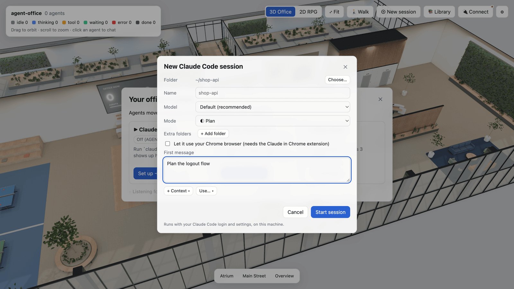</td>
<td width="50%">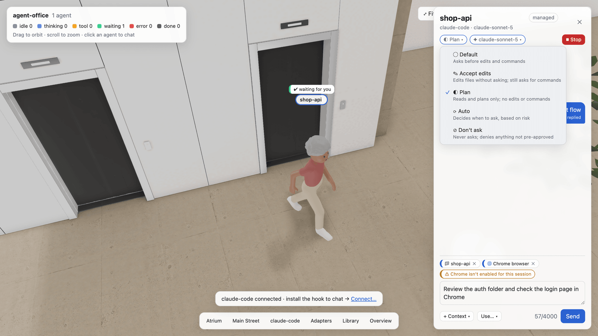</td>
</tr>
<tr>
<td>New session: folder, model, mode, extra folders and an optional Chrome browser.</td>
<td>Switch mode (Default, Accept edits, Plan, Auto, Don't ask) and model live, and attach context.</td>
</tr>
</table>

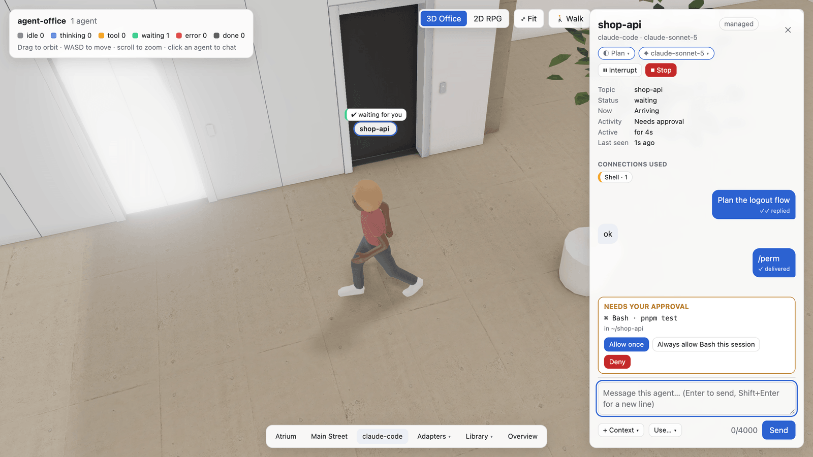

- **Mode and model** change live, for the rest of the session. Each change is noted in the thread.
- **Permission cards:** when the session needs approval (Default mode), the agent waits in a phone booth and the panel shows a short summary, never the raw tool input: **Allow once**, **Always allow \<tool\> this session**, or **Deny**.
- **Interrupt** stops the current turn; **Stop** ends the session (the agent leaves by elevator). Quitting the app asks before stopping running sessions.
- **Bypass permissions** mode is hidden unless you turn on Settings → "Allow Bypass permissions mode" (with a confirmation).
- Up to 6 sessions run at once. They end when the app quits.
- Needs Claude Code installed and signed in (`claude`, then `/login`).

## Appearance

Settings → **Appearance**: System (default), Light or Dark. Everything follows it: panels, name tags, the loading screen, the window and the 3D scene's background. Both themes have the same features, and text contrast is at least 4.5:1 in each (checked by `desktop/e2e/theme.spec.ts`).

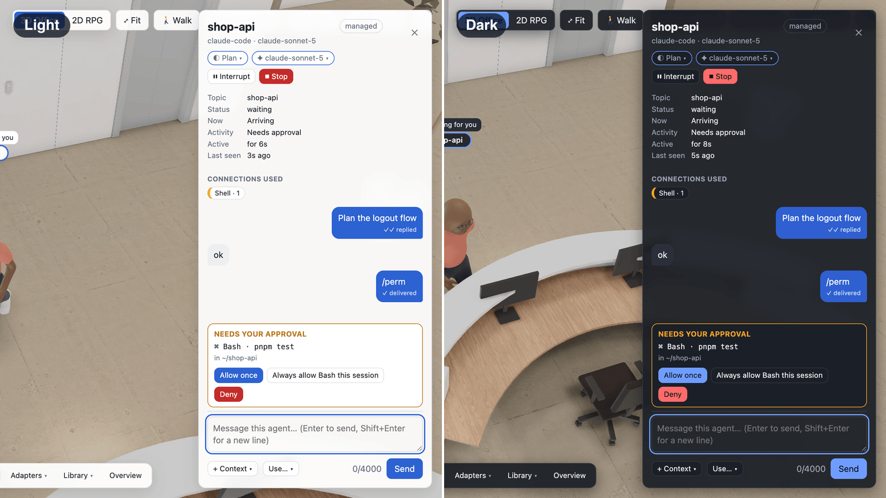

## Adapters

Every wing has an **Adapters room**: one **station** per connection its agents can use. Each
station's screen lists what it **can see** (for example `project: shop-api`, `cmd: git`,
`host: docs.example.com`) and its tools; a ring on the floor lights up in the connection's color
while it's in use.

<table>
<tr>
<td width="50%">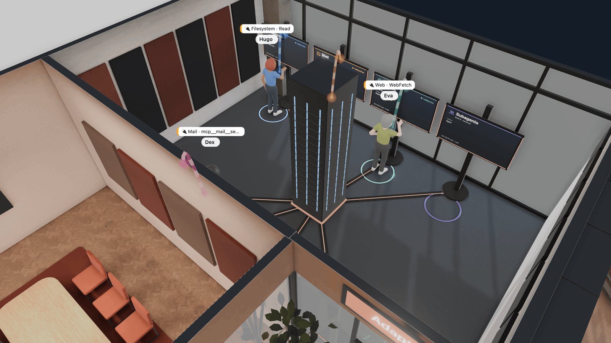</td>
<td width="50%">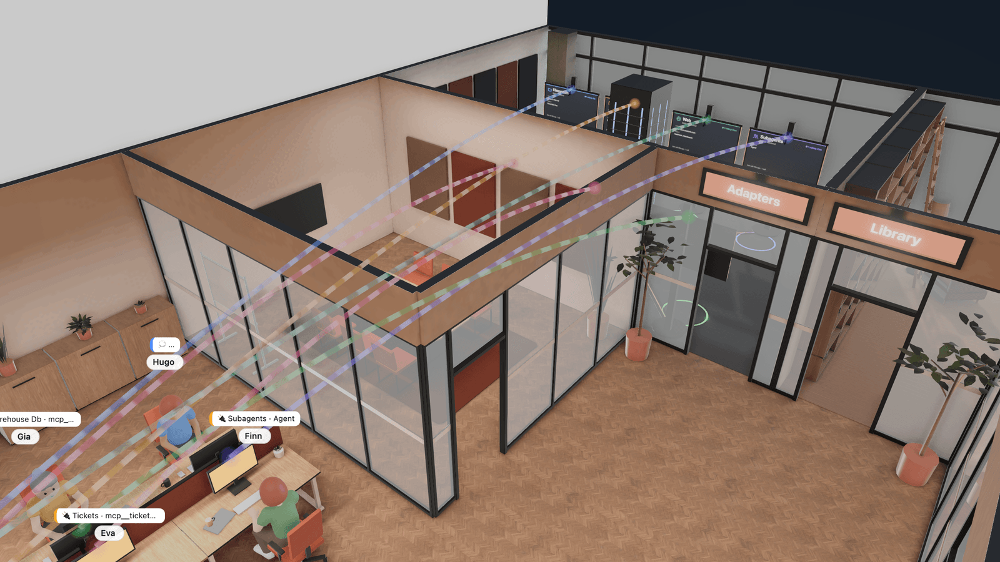</td>
</tr>
<tr>
<td>Stations: Filesystem, Shell, Web, Subagents, then MCP servers, APIs and databases.</td>
<td>A tool call draws a flowing link from the agent's desk to the station, colored by kind.</td>
</tr>
<tr>
<td width="50%">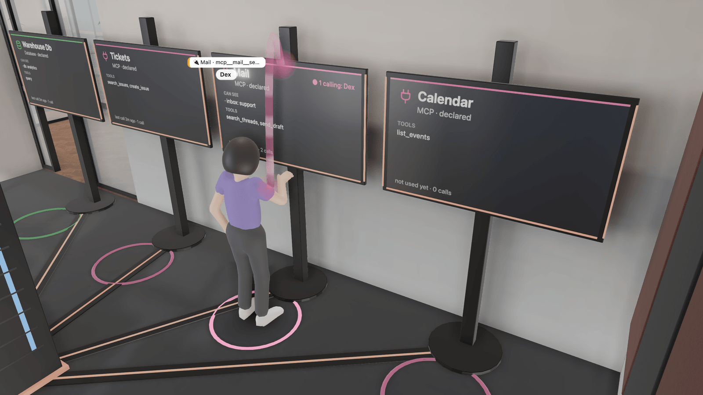</td>
<td width="50%">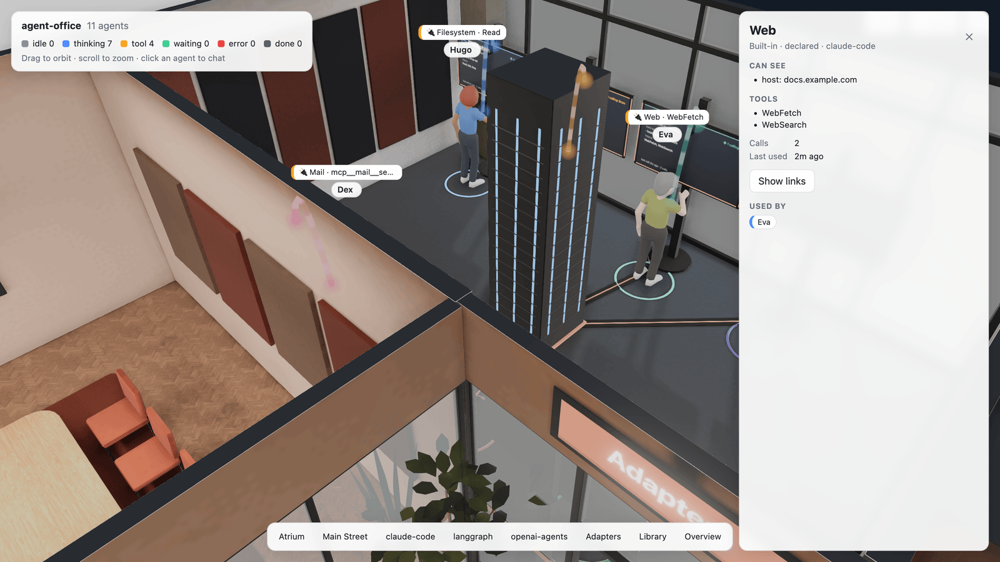</td>
</tr>
<tr>
<td>Sustained use: the agent walks to the station and works there standing.</td>
<td>Click a station for its panel: what it can see, its tools, who uses it and how often.</td>
</tr>
</table>

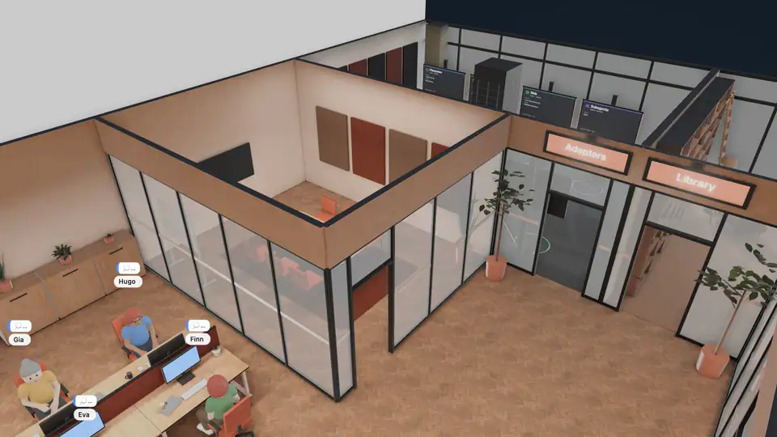

- **Call vs visit.** A tool call that uses a connection shows a link while the tool runs (plus a
  0.6 s fade); the agent stays at its desk. Using the same connection for 20 s continuously, or 4
  times within 60 s, sends the agent to the station. It returns after 8 s without use.
- **Where connections come from:**
  - **Built-ins** for Claude Code: Filesystem, Shell, Web and Subagents.
  - **Configured MCP servers:** only the server **names** from `~/.claude.json` (never commands,
    arguments or env). `claude_ai_*` connectors appear once used.
  - **Observed tools:** a tool used but not declared appears as an undeclared station.
  - **Declared by any framework** through the HTTP API (below).
- **Privacy:** sources send only names, host names, project basenames and the first word of a
  command (`cmd:git`); never URLs, paths, arguments, command lines, file contents or env values.
  See [`docs/capabilities.md`](docs/capabilities.md).

```sh
TOKEN=$(cat ~/.agent-office/token)
curl -s -X POST http://127.0.0.1:4317/api/providers/langgraph/capabilities \
  -H "Authorization: Bearer $TOKEN" -H 'Content-Type: application/json' \
  -d '[
    {"id": "mcp:postgres", "category": "adapter", "kind": "database", "label": "Postgres", "sees": ["db: analytics"]},
    {"id": "api:chat", "category": "adapter", "kind": "api", "label": "Chat", "tools": ["post_message"]}
  ]'
# A tool call that uses it: classified from tool + target, or named explicitly with "capability".
curl -s -X POST http://127.0.0.1:4317/api/events \
  -H "Authorization: Bearer $TOKEN" -H 'Content-Type: application/json' \
  -d '{"agentId": "bot-1", "provider": "langgraph", "status": "tool", "tool": "run_query", "capability": "mcp:postgres"}'
```

## Library

Next to the Adapters room, every wing has a **Library**: the provider's **skills** are books with
readable spines, its **rules** are boards on the wall with their title and first sentence, and
its **memory** entries are notebooks on a rack. There's a reading table for agents who need to
sit down with a book.

**📚 Library** (top right) lists all of it, for any provider: Skills, Rules, Memory and Adapters tabs, with search, scope, summary and usage. That includes the items that don't fit on the shelves ("Not on a shelf"). Pick one and the camera flies to it, close enough to read, and its panel opens. In the 3D view, hover a spine, board, notebook or station to see its name, and click it to open it. The **Library ▾** and **Adapters ▾** view buttons fly to any provider's rooms, including a head-on **Rules wall** view.

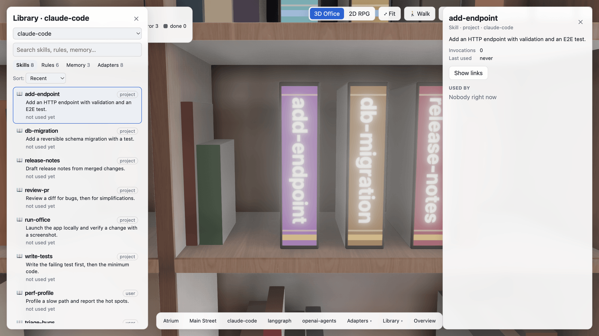

<table>
<tr>
<td width="50%">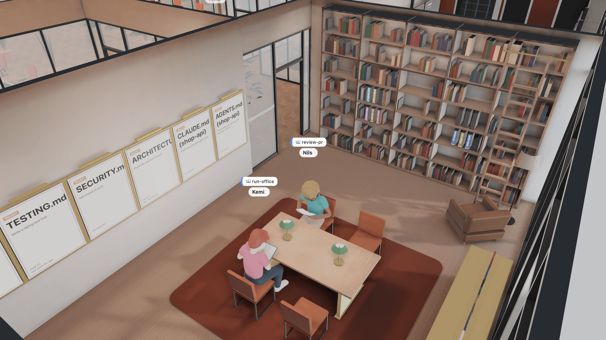</td>
<td width="50%">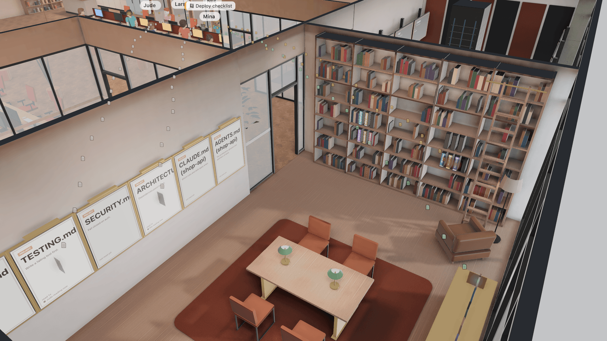</td>
</tr>
<tr>
<td>Skill books on the shelves, rule boards on the wall, the reading table.</td>
<td>Consulting a skill or reading a rule from the desk: a stream of pages, and the spine or board glows.</td>
</tr>
<tr>
<td width="50%">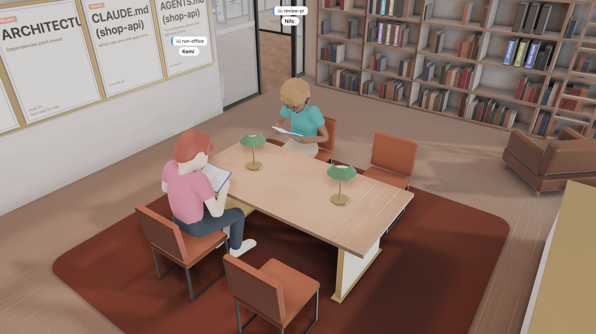</td>
<td width="50%">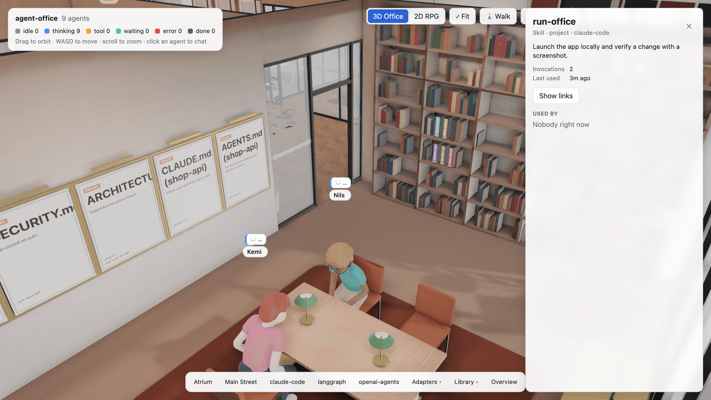</td>
</tr>
<tr>
<td>Several uses in a row: the agent picks the book from the shelf and reads it at the table.</td>
<td>Click a book, board or notebook: its description, scope and who used it.</td>
</tr>
</table>

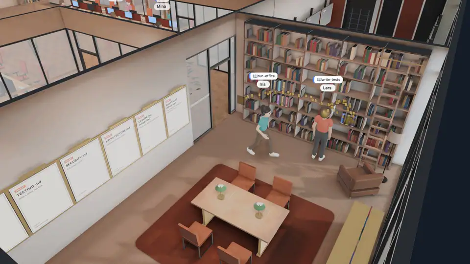

- **What's discovered** (Claude Code; Settings → "Discover capabilities"):
  - **Skills:** `~/.claude/skills`, the project's `.claude/skills` and plugin skills: name and
    description (first 160 characters).
  - **Rules:** the project's `CLAUDE.md`, `AGENTS.md` and `.claude/rules/*.md`, and your
    `~/.claude/CLAUDE.md` and `~/.claude/rules`: title and first sentence.
  - **Memory:** titles only, never the content.
- **Call vs visit.** A `Skill` call or a `Read` of a rule glows its book or board for 6 s and
  draws a page link; the agent stays put. Two different skills or rules within 60 s (or a skill
  while idle or thinking for 10 s) send the agent to the Library to pick the book and read. It
  returns after 10 s without library use.
- **Other frameworks** declare skills and rules with the same capabilities API, and report use
  with `"tool": "Skill", "target": "skill:<name>"` or `"tool": "Read", "target": "rule:project:<file>"`:

```sh
curl -s -X POST http://127.0.0.1:4317/api/providers/langgraph/capabilities \
  -H "Authorization: Bearer $TOKEN" -H 'Content-Type: application/json' \
  -d '[
    {"id": "skill:triage", "category": "skill", "kind": "skill", "label": "triage", "summary": "Sort incoming tickets."},
    {"id": "rule:project:AGENTS.md", "category": "rule", "kind": "project-rules", "label": "AGENTS.md (support-bot)", "scope": "project"}
  ]'
```

## Tray and notifications

The app keeps running in the tray (menu bar on macOS) when you close the window. The tray menu
shows live counts per status, the agents waiting for you, and shortcuts to the hook and settings.
A native notification tells you when an agent starts waiting, replies to you, or hits an error;
click it to jump to that agent.

<table>
<tr>
<td width="50%"></td>
<td width="50%"></td>
</tr>
<tr>
<td>The tray menu: counts, who's waiting, hook and settings.</td>
<td>A notification when an agent waits for you.</td>
</tr>
</table>

## Settings

⚙ Settings: install or remove the Claude Code hook, turn sessions and capability discovery on or
off, notifications, open at login, the local API port, the graphics preset (with the live frame
rate) and updates.

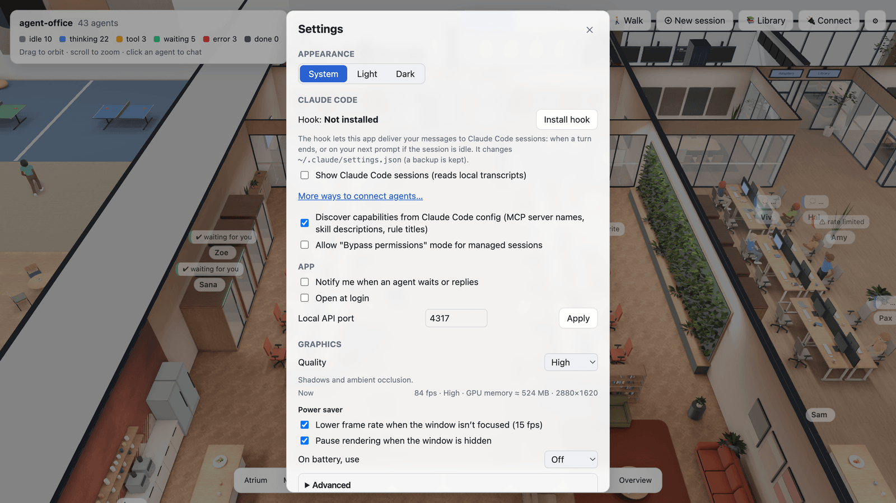

## Walk mode

Press `F` or **🚶 Walk** to walk through the office in first person: WASD to move, Shift to
sprint, `E` to talk to the agent (or open the station, book or board) under the crosshair, and
`Esc` to go back to orbiting. Ceilings appear while you walk.

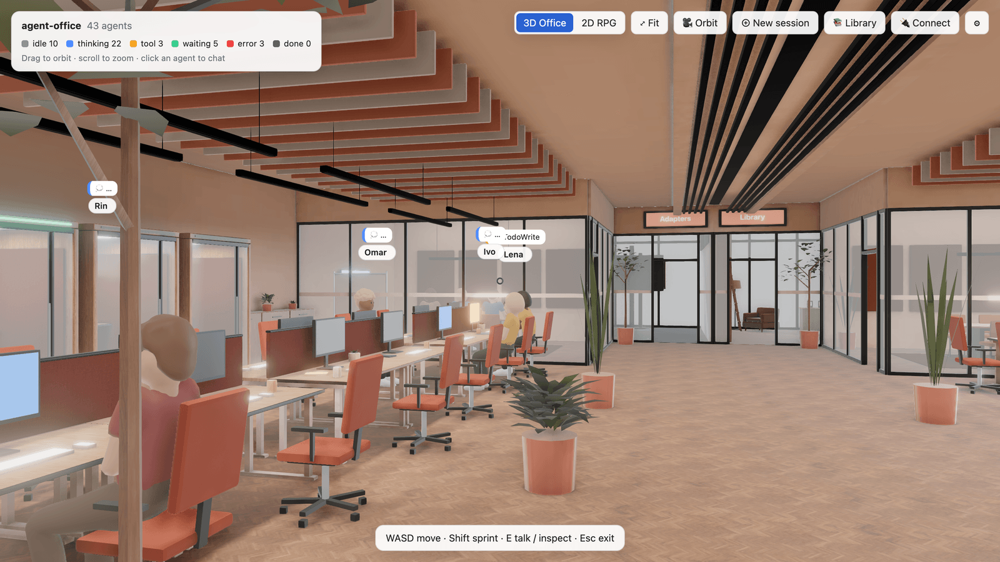

## Graphics

⚙ Settings → **Graphics** picks a quality preset. Everything applies immediately and is saved with your settings.

| Preset  | For                                                                                                                                                                                                                                          |
| ------- | -------------------------------------------------------------------------------------------------------------------------------------------------------------------------------------------------------------------------------------------- |
| Auto    | The default. Starts from what your computer can do (software rendering → Minimal, integrated graphics → Low, Apple M1/M2 → Medium, faster GPUs → High), then steps down or up to keep the frame rate smooth, never above that starting tier. |
| Minimal | Very old or software-rendered computers: 30 fps, ¾ resolution, no shadows or effects, name tags only nearby, static links, the smallest lightmaps.                                                                                           |
| Low     | Laptops with integrated graphics: 60 fps, contact shadows only, no post-processing, nearby name tags, half-size lightmaps.                                                                                                                   |
| Medium  | Balanced: soft shadows, glow and anti-aliasing.                                                                                                                                                                                              |
| High    | Ambient occlusion and sharper shadows, up to Retina pixel density.                                                                                                                                                                           |
| Ultra   | Native pixel density, the largest shadow maps and more animated characters at full detail.                                                                                                                                                   |

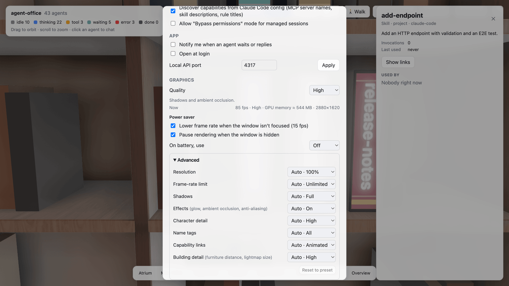

- **Live numbers:** "Now" shows the frame rate, the preset in force, an estimate of GPU memory and the drawing size.
- **Power saver:** 15 fps while the window isn't focused, no rendering while it's hidden or minimized, and optionally a lighter preset on battery.
- **Advanced:** override single features on top of the preset: resolution, frame-rate limit, shadows, effects, character detail, name tags (all, nearby, or only the selected agent), capability links (animated, static or off) and building detail. "(custom)" marks overrides; **Reset to preset** clears them.
- **If 3D can't start** (no WebGL), a card explains it and offers software rendering on Windows and Linux. macOS has no software WebGL fallback, so that option isn't offered there.
- **Smaller on the GPU:** textures shared across the building are loaded once, and lightmaps come in three sizes picked by the preset.

Low (left) and Ultra (right), same view:

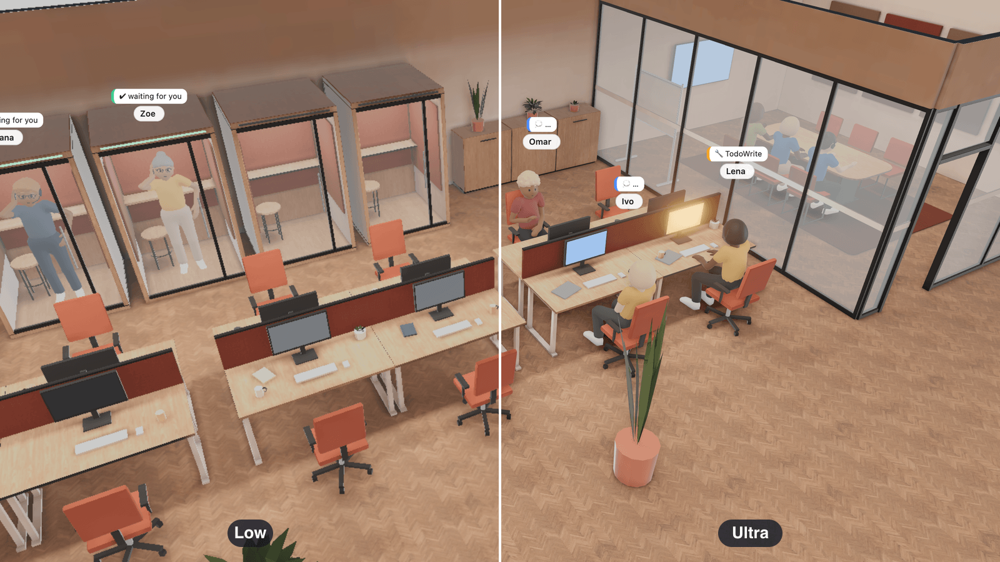

## 2D RPG mode (optional)

Prefer pixels? The **3D Office | 2D RPG** switch (top right) shows the **same live office** as a GBA-style, top-down pixel-art world. It's an extra view, not a replacement: the 3D office stays the default, and switching doesn't restart agents or lose chats, sessions or permissions.

<table>
<tr>
<td width="50%">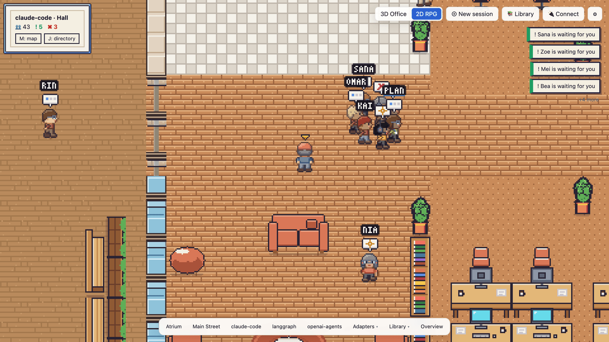</td>
<td width="50%">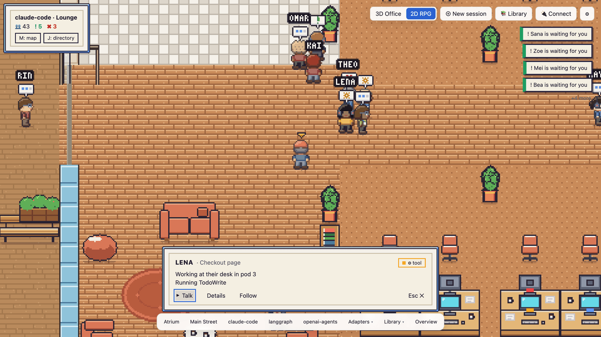</td>
</tr>
<tr>
<td>Walk the office with WASD or the arrow keys. Agents act out their real status.</td>
<td>Walk up to an agent and press <b>E</b>: Talk opens the usual chat panel.</td>
</tr>
</table>

<table>
<tr>
<td width="50%">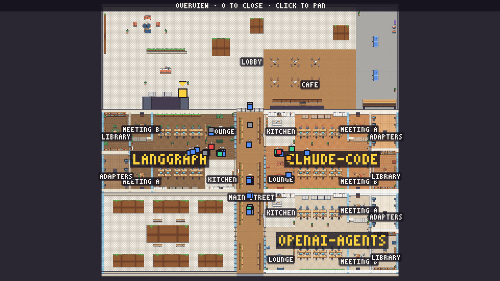</td>
<td width="50%">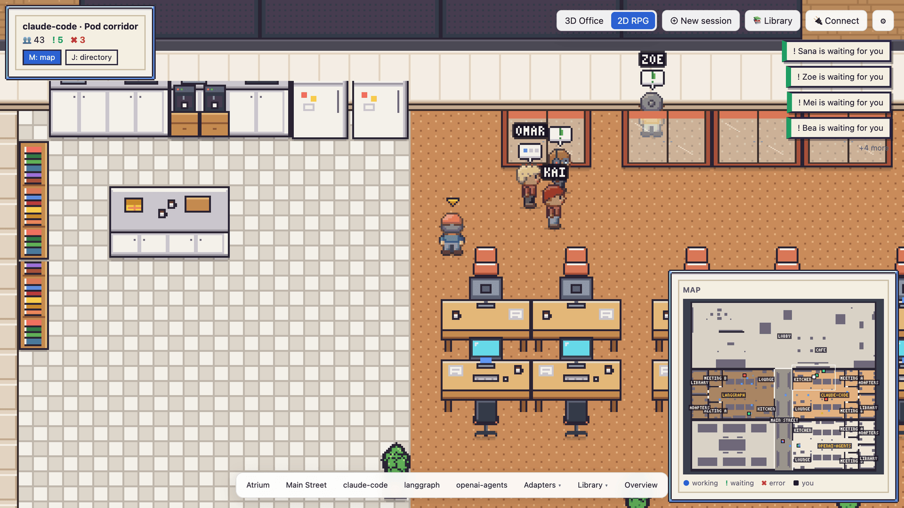</td>
</tr>
<tr>
<td><b>O</b>: the overview, a labelled floor plan. Click to pan; keep walking while it's open.</td>
<td><b>M</b>: the minimap. Click to pan there, Shift-click to travel.</td>
</tr>
</table>

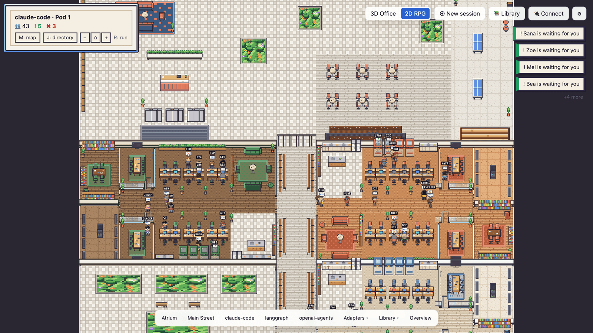

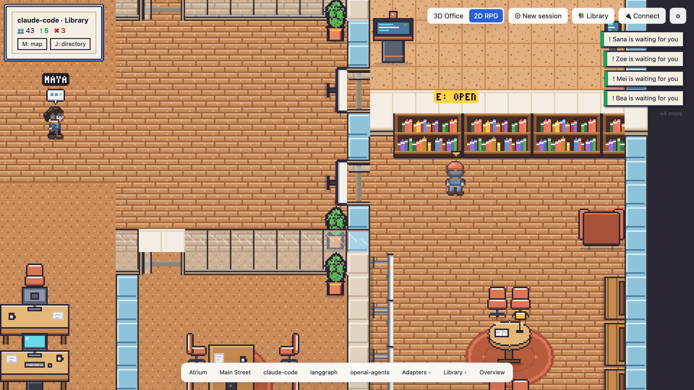

- **The same agents, the same places:** agents arrive by elevator, sit at their pod, meet with their subagents, wait in phone booths, visit the Library and the Adapters room, and leave by elevator, exactly as in 3D. The 2D view draws the same decisions.
- **Talk to agents:** **E** (or a click) opens a dialogue. **Talk** opens the regular chat panel, with history, context, tools, and a managed session's mode, model and permission card. Subagents point you to their parent.
- **Library and Adapters:** E on a bookshelf, board or station opens its details or the Library browser.
- **Never miss a request:** alerts at the top right ("! Ada is waiting for you", "needs approval") take you there. **M** opens the minimap, **J** a directory with fast travel, **O** the overview, and the mouse wheel zooms.
- **Walk in every view:** you can keep moving while the overview is open, while following an agent, and with the chat panel or Library open (typing in a text field never moves you). **Space** or **Esc** brings the camera back to you.
- **What you see is what blocks:** furniture collides exactly where it's drawn, walls sit where they are in 3D, and every corridor and door the agents use is walkable.
- **GBA scale:** 16 px per metre, so one screen shows most of a wing and the office is a short walk across. Every desk, booth and chair is exactly where it is in 3D. Walk at 3 m/s, sprint with Shift, **R** to run by default, and **-** / **=** (or − ⌂ + in the HUD) to zoom out in crisp steps down to most of the office.
- Original pixel art (no third-party sprites), 16 px tiles, crisp integer scaling. It runs at 120 fps with 36 MB of textures, and works without WebGL.

How it's built (one `SceneView` port, two renderers): [docs/2d-architecture.md](docs/2d-architecture.md).

## Characters

Every agent is one of a family of hand-made characters (varied skin tones, hair, glasses,
headsets and badges), modeled, rigged and animated in Blender by committed scripts. They have 22
in-place animation clips, blended with crossfades: typing, thinking, talking, phoning, drinking
coffee, lounging, ping-pong, waving, walking, stepping out of the elevator, working at a station,
picking a book from the shelf and reading.

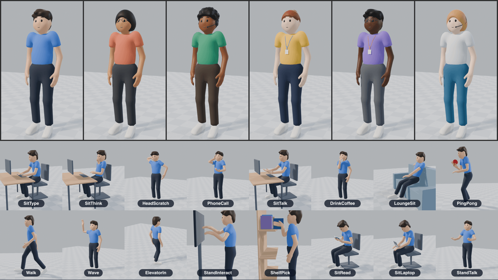

## Download

Get the latest installer from [Releases](https://github.com/arxdsilva/agent-office/releases):

| OS                              | File                 | Notes                                                                                                                                                                                                                                                                                  |
| ------------------------------- | -------------------- | -------------------------------------------------------------------------------------------------------------------------------------------------------------------------------------------------------------------------------------------------------------------------------------- |
| macOS (Apple Silicon and Intel) | `.dmg`               | Builds are **unsigned** until a Developer ID is configured. First launch: right-click the app → **Open**, or run `xattr -dr com.apple.quarantine /Applications/agent-office.app`. Unsigned macOS builds can't self-update, so the app shows a download link when a new version is out. |
| Windows                         | `.exe` (NSIS)        | SmartScreen may warn on first run because the build is unsigned. Auto-updates.                                                                                                                                                                                                         |
| Linux                           | `.AppImage` / `.deb` | AppImage auto-updates. `.deb` notifies you instead.                                                                                                                                                                                                                                    |

## Using it with Claude Code

1. Open agent-office. Any Claude Code session active in the last 10 minutes appears in the `claude-code` wing, at a desk pod named after the session title. Its subagents sit next to it, and join it in a meeting room while they work.
2. **To message sessions:** 🔌 Connect → Claude Code → **Install**. You can also use ⚙ Settings, the tray menu, or the button shown in the chat panel.

When you send a message:

| Session state                       | Delivery                                                                                                                                                                  |
| ----------------------------------- | ------------------------------------------------------------------------------------------------------------------------------------------------------------------------- |
| Working (thinking or running tools) | When its current turn ends, the **Stop** hook hands Claude your message and Claude continues with it. Claude's answer is posted back to the chat when that turn finishes. |
| Idle, waiting for you               | On your next prompt in Claude Code, the **UserPromptSubmit** hook adds the message as context. Claude Code has no hook that can wake an idle session.                     |

How the hook works:

- It's a small wrapper in the app's data folder that runs the app's own binary in Node mode, so you don't need Node installed.
- It **fails open**: if the app isn't running, it exits silently within 1.5s and never blocks your session.
- Installing writes `~/.claude/settings.json.agent-office.bak` first.
- **Uninstall the hook (Settings) before deleting the app.**

**Capabilities:** the wing's Adapters room shows the built-in connections and the names of your configured MCP servers; its Library shows your skills, rules and memory titles (see [Adapters](#adapters) and [Library](#library)). Turn this off in Settings → "Discover capabilities".

**What is read from transcripts:** line types, tool names, the short Bash/Agent `description`, the model, the session title and the subagent type. For capabilities, only the tool's target in a short form: a project basename, a host name, the first word of a Bash command, or a skill, rule or memory name. Snippets are capped at 80 characters, and prompts and outputs are never shown. Nothing is logged or stored. The exception is Claude's answer to a message you sent from the app, which is shown in the chat.


## HTTP API (for any agent framework)

While the app runs, it serves a local API on `127.0.0.1:4317`; the port can be changed in Settings or in **Connect → Any framework**, which also has a ready-made snippet for curl, Python and JavaScript. Every write needs the token in `~/.agent-office/token` (created on first start, mode `0600`).

```sh
TOKEN=$(cat ~/.agent-office/token)
curl -X POST http://127.0.0.1:4317/api/events \
  -H "authorization: Bearer $TOKEN" -H 'content-type: application/json' \
  -d '{"agentId":"lg:triage-1","name":"Triage","provider":"langgraph","topic":"Support inbox","status":"tool","tool":"search_tickets"}'
```

### Events

You can POST a single event or an array of up to 500. Events are **partial updates**: send only what changed.

| Field        | Type        | Required | Meaning                                                                                                                                                                            |
| ------------ | ----------- | -------- | ---------------------------------------------------------------------------------------------------------------------------------------------------------------------------------- |
| `agentId`    | string ≤200 | yes      | Stable id. Namespace it, e.g. `lg:triage-1`.                                                                                                                                       |
| `name`       | string ≤100 |          | Label above the agent's head                                                                                                                                                       |
| `provider`   | string ≤100 |          | Zone. Defaults to `source`, then `http`.                                                                                                                                           |
| `topic`      | string ≤200 |          | Row. Defaults to `untitled`.                                                                                                                                                       |
| `model`      | string ≤100 |          | Shown in the chat panel                                                                                                                                                            |
| `kind`       | string ≤100 |          | Role or type, e.g. `planner`                                                                                                                                                       |
| `parentId`   | string ≤200 |          | Spawning agent; this agent sits next to it                                                                                                                                         |
| `status`     | enum        |          | `idle` · `thinking` · `tool` · `waiting` · `error` · `done`                                                                                                                        |
| `tool`       | string ≤100 |          | Tool in use, shown when `status` is `tool`                                                                                                                                         |
| `target`     | string ≤100 |          | What the tool touched, in a short form: `host:github.com`, `cmd:git`, `skill:<name>`, `rule:project:<file>`, … ([capabilities](docs/capabilities.md#3-the-target-grammar-privacy)) |
| `capability` | string ≤120 |          | Explicit capability id the tool uses, e.g. `mcp:postgres` (otherwise classified from `tool` and `target`)                                                                          |
| `text`       | string ≤500 |          | Short activity line                                                                                                                                                                |
| `source`     | string ≤50  |          | Producer name                                                                                                                                                                      |
| `ts`         | epoch ms    |          | Event time. Older events never overwrite newer state.                                                                                                                              |

Timing rules:

- `thinking` and `tool` revert to `idle` after 60 seconds without events.
- Agents that stay silent for 10 minutes are removed.
- `done` agents leave after 30 seconds.

### Capabilities: adapters, skills and rules

`POST /api/providers/:provider/capabilities` declares what a provider's agents can use: a JSON
array of up to 64 `{id, category, kind, label, summary?, scope?, sees?, tools?}`. Declarations
merge with what was observed. Responses: `202 {"declared": n}`, `400`, `401`, `413`. Examples are
in [Adapters](#adapters) and [Library](#library); the full classification is in
[`docs/capabilities.md`](docs/capabilities.md).

### Inbox: let users talk to your agent

| Method and path                                                       | Who calls it   | Purpose                                                  |
| --------------------------------------------------------------------- | -------------- | -------------------------------------------------------- |
| `GET /api/agents/:id/inbox?claim=1&wait=25`                           | Your agent     | Long-poll; returns `{messages}` and marks them delivered |
| `POST /api/agents/:id/replies` `{text, inReplyTo?, requireAwaiting?}` | Your agent     | Answer; the app shows it and marks the message replied   |
| `POST /api/agents/:id/messages` `{text}`                              | Scripts or CLI | Queue a message (the app itself uses IPC)                |
| `GET /api/agents`, `GET /api/agents/:id/messages`, `GET /api/health`  | Anyone local   | Read-only                                                |

```python
import json, os, urllib.request

BASE = "http://127.0.0.1:4317/api/agents/lg%3Atriage-1"
TOKEN = open(os.path.expanduser("~/.agent-office/token")).read().strip()

def call(method, path, body=None):
    req = urllib.request.Request(BASE + path, method=method, data=body and json.dumps(body).encode(),
                                 headers={"authorization": f"Bearer {TOKEN}", "content-type": "application/json"})
    with urllib.request.urlopen(req, timeout=30) as r:
        return json.loads(r.read() or b"{}")

while True:
    for msg in call("GET", "/inbox?claim=1&wait=25")["messages"]:
        answer = f"on it: {msg['text']}"          # ← hand the message to your agent here
        call("POST", "/replies", {"text": answer, "inReplyTo": msg["id"]})
```

## Security

The app can inject text into live agent sessions, so it is locked down:

- **Local API**
  - It binds to `127.0.0.1` only.
  - Requests with a foreign `Host` get 421, which blocks DNS rebinding.
  - Requests from a foreign `Origin` get 403.
  - Writes need the bearer token (401 otherwise).
  - All input is validated with zod, with size limits and a message rate limit.
  - The API serves no web page and no WebSocket.
- **Electron**
  - The renderer is sandboxed and context-isolated, with no Node integration.
  - The production renderer is served from a privileged `app://renderer` scheme (read-only, contained in the bundled files, path traversal refused), so the CSP can stay `'self'`-only: `script-src 'self' 'wasm-unsafe-eval'; connect-src 'self'`. WebAssembly may compile (the mesh decoder); JavaScript `eval` and every remote origin stay blocked.
  - Navigation and popups are blocked, and only the pointer-lock and notifications permissions are allowed.
  - Every IPC payload is validated and its sender is checked.
- **Agent text** is always rendered as text, never as HTML.

The token protects you from websites. It does not protect you from other programs running as your user.

## Controls

| Input                                    | Action                                                                       |
| ---------------------------------------- | ---------------------------------------------------------------------------- |
| Drag / scroll                            | Orbit and zoom                                                               |
| WASD or arrow keys (orbit)               | Glide the camera over the office (Shift for faster); stops following         |
| Click a name tag or agent                | Open the chat and focus the camera                                           |
| Click a station, book, board or notebook | Open its capability panel                                                    |
| View bar (bottom)                        | Jump to the atrium, Main Street, a wing, the Adapters room or the Library    |
| `⤢ Fit`                                  | Frame the whole office                                                       |
| `F` or `🚶 Walk`                         | First-person mode: WASD to move, Shift to sprint, `E` to talk, `Esc` to exit |
| 2D: WASD, Shift, `R`                     | Walk, sprint, toggle running; `-` / `=` or the wheel zoom (crisp steps)      |
| `⚙`                                      | Settings: hook, notifications, open at login, API port, graphics, updates    |
| Closing the window                       | Keeps running in the tray. Quit from the tray menu or with ⌘Q.               |

## Architecture

agent-office uses a **hexagonal architecture** (ports and adapters), enforced by `make arch`:

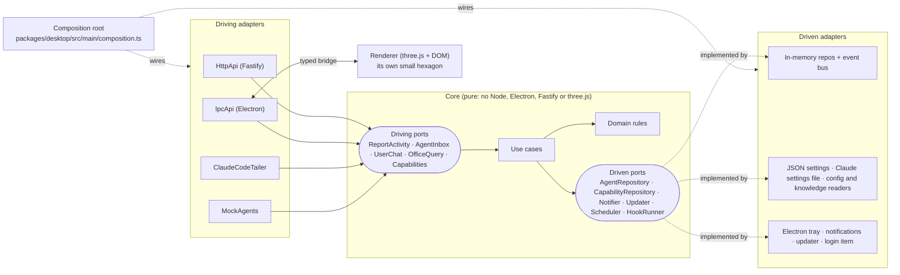

| Package             | Contents                                                                    |
| ------------------- | --------------------------------------------------------------------------- |
| `packages/shared`   | Contracts: HTTP and IPC schemas, capability DTOs, status colors, grouping   |
| `packages/core`     | Domain, use cases, ports, plus a test kit of contract suites and fakes      |
| `packages/adapters` | Node adapters: HTTP API, transcript tailer, config readers, mock agents, fs |
| `packages/desktop`  | Electron main process, preload, composition root, packaging, app E2E tests  |
| `packages/web`      | Renderer: three.js scene and DOM views behind ports, driven by a controller |

Office organization lives in one place, `byProviderAndTopic` in `packages/shared/src/grouping.ts`. Swap it to reorganize the office.

## Building from source

Requires Node 22+ and pnpm (`corepack enable`).

```sh
make install
make dev-mock        # app window with hot reload, simulated agents and your live Claude Code sessions
make check           # format, typecheck, arch, unit tests with ≥70% coverage, E2E, build (what CI runs)
make build test-ui   # Playwright drives the built Electron app
make package         # unpacked app for this OS → packages/desktop/dist
make package-dist    # installers for this OS
make screenshots     # README stills and clips → docs/screenshots (after make build)
make screenshots-macos  # macOS only: the real tray menu and a notification
```

- **TDD:** every behavior change starts with a failing test.
- **Contract suites:** every driven-port implementation passes its port's contract suite.
- **Coverage:** at least 70% per package.
- **Releases:**
  1. Run `make release VERSION=x.y.z`. It sets the version and prints the tag commands.
  2. Pushing the tag builds installers on macOS, Windows and Linux into a **draft** GitHub release.
  3. Signing is used automatically when the `CSC_*` and `APPLE_*` secrets exist.

## Building the assets

The building, furniture and characters are made in **Blender 5.2** by committed Python scripts (`assets/blender/`). Nothing that ships is edited by hand; every `.glb` comes out of the pipeline.

```sh
brew install git-lfs && git lfs install   # binary assets are stored with Git LFS (once per machine)
git lfs pull                              # fetch the committed assets
make assets-draft    # fast build for iteration (low bake samples, small lightmaps; gitignored output)
make asset-previews  # Eevee stills of every module → assets/previews/
make assets-test     # Blender-side tests: naming, counts, loop continuity, budgets, no logos
make assets          # final build → packages/web/public/assets/ (validated by assets/validate.test.ts in CI)
```

- The Blender binary comes from `$BLENDER`, falling back to `/Applications/Blender.app/Contents/MacOS/Blender`. The build refuses any Blender other than 5.2.
- `docs/graphics-contract.md` is the contract between the assets and the renderer: coordinates, anchors, nav graphs, clip names and budgets (≤ 45 MB in total).
- CI does not run Blender. It checks out the LFS files and validates them (`gltf-validator`, budgets, anchors, nav connectivity, character clips).
- Optional, for art direction: the [Blender MCP](https://github.com/ahujasid/blender-mcp) lets Claude Code inspect the scene and take viewport screenshots. Register it with `claude mcp add blender --scope user -- uvx blender-mcp`, then click **Connect** in Blender's MCP sidebar. Enable only the Poly Haven integration.
- Textures and HDRIs are CC0 from Poly Haven, listed in `assets/LICENSES.md`. No logos or trademarks appear in any asset; wing signs show the provider id as plain text drawn at runtime.

Working with an AI assistant? Start from [`AGENTS.md`](AGENTS.md), which has the architecture, glossary, rules and definition of done. Claude Code users also get project skills: `/run-office`, `/add-port-adapter`, `/add-event-source`, `/protocol-change`, `/scene-change`, `/asset-change`, `/interaction-change` and `/desktop-change`.

## Roadmap

- Office organization v2 (the grouping strategy is pluggable)
- Persistence and replay, as a new `AgentRepository` adapter
- OpenTelemetry GenAI spans as a source
- Code signing and notarization for macOS releases
- Custom avatars and office themes

## License

[MIT](LICENSE)
