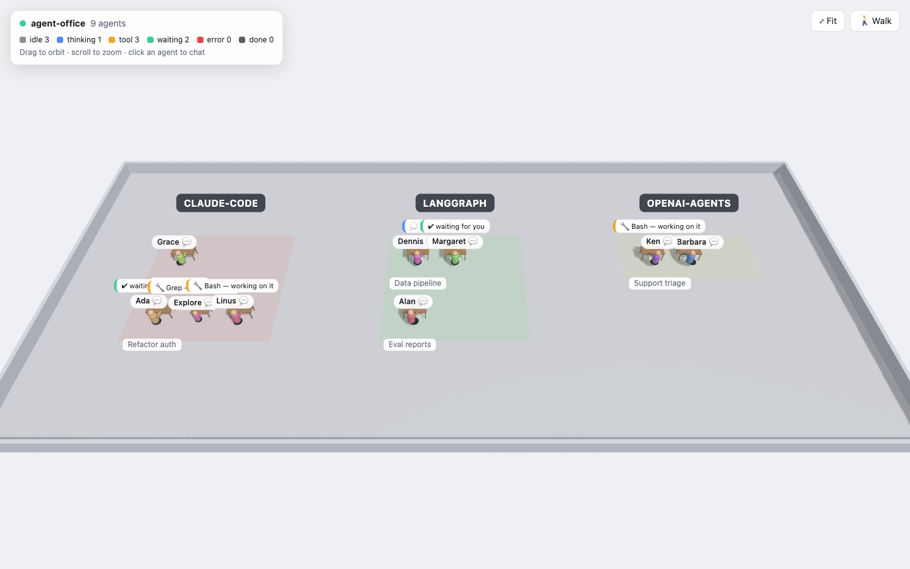

# agent-office

**Walk through your AI agents like an office.** agent-office is a local server plus a three.js page
that shows every running agent as a worker at a desk. Agents are grouped into **zones by provider**
and **rows by conversation topic**. You can see at a glance who is thinking, who is running a tool
and who is waiting for you, and you can **send them messages** from the browser.



## Features

- **Live 3D office.** Each provider (Claude Code, OpenAI Agents, LangGraph, your own) gets a zone, and each topic gets a row of desks. Subagents sit next to their parent.
- **Status at a glance.** Monitors and speech bubbles show the current status and tool.
- **Chat with agents.** Messages go into a per-agent inbox. Claude Code sessions receive them through an opt-in hook, and any other agent can long-poll the inbox over HTTP.
- **Zero-config Claude Code.** Running sessions and their subagents appear automatically, taken from the transcripts Claude Code already writes.
- **Walk mode.** First-person WASD through the office: press `E` to talk to the agent you're looking at.
- **Generic event API.** Any framework can report agents with one `POST`.

## Quickstart

Requires Node 22+ and pnpm (`corepack enable`).

```sh
make install
make dev-mock          # simulated agents + your live Claude Code sessions
open http://localhost:5173
```

`make dev` runs without the simulated agents. For a single production process, run `make build && make start` and open http://localhost:4317.

Run `make help` to list every command.

## Use with Claude Code

`make dev` tails `~/.claude/projects/**/*.jsonl`. Any session or subagent active in the last 10 minutes shows up in the `claude-code` zone, in a row named after the session title.

**What is read:** the line type, tool names, the short Bash/Agent `description`, the model, the session title and the subagent type. Snippets are capped at 80 characters, and prompts and outputs are never shown. Nothing is logged or written to disk.

### Talking to a Claude Code session

```sh
make install-hook     # adds a Stop + UserPromptSubmit hook to ~/.claude/settings.json (asks first, keeps a backup)
make uninstall-hook   # removes only that hook
```

When you send a message from the UI:

| Session state                       | Delivery                                                                                                                                                                  |
| ----------------------------------- | ------------------------------------------------------------------------------------------------------------------------------------------------------------------------- |
| Working (thinking or running tools) | When its current turn ends, the **Stop** hook hands Claude your message and Claude continues with it. Claude's answer is posted back to the chat when that turn finishes. |
| Idle, waiting for you               | On your next prompt in Claude Code, the **UserPromptSubmit** hook adds the message as context. Claude Code has no hook that can wake an idle session.                     |

The hook **fails open**: if agent-office isn't running, it exits silently within 1.5s and never blocks your session.

## Event API

Report agents from anything. Every write needs the token from `~/.agent-office/token`, which is created on first start with mode `0600`.

```sh
TOKEN=$(cat ~/.agent-office/token)
curl -X POST http://127.0.0.1:4317/api/events \
  -H "authorization: Bearer $TOKEN" -H 'content-type: application/json' \
  -d '{"agentId":"triage-1","name":"Triage","provider":"langgraph","topic":"Support inbox","status":"tool","tool":"search_tickets"}'
```

You can POST a single event or an array of up to 500. Events are **partial updates**: send only what changed.

| Field      | Type        | Required | Meaning                                               |
| ---------- | ----------- | -------- | ----------------------------------------------------- |
| `agentId`  | string ≤200 | yes      | Stable id. Namespace it, e.g. `lg:triage-1`.          |
| `name`     | string ≤100 |          | Label above the agent's head                          |
| `provider` | string ≤100 |          | Zone. Defaults to `source`, then `http`.              |
| `topic`    | string ≤200 |          | Row. Defaults to `untitled`.                          |
| `model`    | string ≤100 |          | Shown in the chat panel                               |
| `kind`     | string ≤100 |          | Role or type, e.g. `planner`                          |
| `parentId` | string ≤200 |          | Spawning agent; this agent sits next to it            |
| `status`   | enum        |          | See below                                             |
| `tool`     | string ≤100 |          | Tool in use, shown when `status` is `tool`            |
| `text`     | string ≤500 |          | Short activity line                                   |
| `source`   | string ≤50  |          | Producer name                                         |
| `ts`       | epoch ms    |          | Event time. Older events never overwrite newer state. |

| Status     | Color | Meaning                                                    |
| ---------- | ----- | ---------------------------------------------------------- |
| `idle`     | grey  | Nothing happening (set automatically after 60s of silence) |
| `thinking` | blue  | The model is working                                       |
| `tool`     | amber | Running a tool                                             |
| `waiting`  | green | Finished its turn, waiting for a human                     |
| `error`    | red   | Something failed                                           |
| `done`     | dim   | Finished; removed after 30s                                |

Agents that stay silent for 10 minutes are removed.

## Inbox API: let users talk to your agent

| Method and path                                     | Who calls it | Purpose                                                  |
| --------------------------------------------------- | ------------ | -------------------------------------------------------- |
| `POST /api/agents/:id/messages` `{text}`            | The UI       | Queue a message (≤4000 chars, max 10/s per agent)        |
| `GET /api/agents/:id/inbox?claim=1&wait=25`         | Your agent   | Long-poll; returns `{messages}` and marks them delivered |
| `POST /api/agents/:id/replies` `{text, inReplyTo?}` | Your agent   | Answer; the UI shows it and marks the message replied    |
| `GET /api/agents/:id/messages`                      | Anyone local | Thread history                                           |

A minimal agent loop in Python:

```python
import json, os, urllib.request

BASE = "http://127.0.0.1:4317/api/agents/lg%3Atriage-1"
TOKEN = open(os.path.expanduser("~/.agent-office/token")).read().strip()

def call(method, path, body=None):
    req = urllib.request.Request(BASE + path, method=method, data=body and json.dumps(body).encode(),
                                 headers={"authorization": f"Bearer {TOKEN}", "content-type": "application/json"})
    with urllib.request.urlopen(req, timeout=30) as r:
        return json.loads(r.read() or b"{}")

while True:
    for msg in call("GET", "/inbox?claim=1&wait=25")["messages"]:
        answer = f"on it: {msg['text']}"          # ← hand the message to your agent here
        call("POST", "/replies", {"text": answer, "inReplyTo": msg["id"]})
```

## Security model

The UI can inject text into live agent sessions, so the server is locked down:

- It binds to `127.0.0.1` by default.
- **Host allowlist.** Requests whose `Host` isn't `localhost:<port>` or `127.0.0.1:<port>` get 421. This blocks DNS rebinding.
- **Origin check.** Browsers on other sites get 403 on every request and WebSocket.
- **Bearer token.** Required for every write and for the WebSocket. The built UI receives it in a meta tag; other websites can't read it.
- All input is validated with zod, with size limits and a message rate limit.
- Agent text is always rendered as text, never as HTML.

The token protects you from **websites**. It does not protect you from other users on the same machine who can reach `127.0.0.1`. To expose the server on a network, set `HOST=0.0.0.0` and `ALLOWED_HOSTS=myhost:4317`, and put it behind something that authenticates.

## Configuration

| Env                                 | Default              | Purpose                                             |
| ----------------------------------- | -------------------- | --------------------------------------------------- |
| `PORT`                              | `4317`               | HTTP and WebSocket port                             |
| `HOST`                              | `127.0.0.1`          | Bind address                                        |
| `ALLOWED_HOSTS`                     |                      | Extra `host:port` values to accept, comma-separated |
| `CLAUDE_PROJECTS_DIR`               | `~/.claude/projects` | Claude Code transcripts                             |
| `AGENT_OFFICE_CLAUDE`               | `1`                  | `0` disables the Claude Code adapter                |
| `AGENT_OFFICE_MOCK`                 | `0`                  | `1` adds simulated agents                           |
| `IDLE_AFTER_MS` / `EXPIRE_AFTER_MS` | `60000` / `600000`   | Silence before idle, and before removal             |
| `AGENT_OFFICE_HOME`                 | `~/.agent-office`    | Token directory                                     |

## Controls

| Input                     | Action                                                                       |
| ------------------------- | ---------------------------------------------------------------------------- |
| Drag / scroll             | Orbit and zoom                                                               |
| Click a name tag or agent | Open the chat and focus the camera                                           |
| `⤢ Fit`                   | Frame the whole office                                                       |
| `F` or `🚶 Walk`          | First-person mode: WASD to move, Shift to sprint, `E` to talk, `Esc` to exit |

## Architecture

```
 Claude Code .jsonl ─tail─▶ claude-code source ─┐                       ┌─▶ WS /ws ─▶ browser (three.js + chat)
 any agent ─POST /api/events─▶ zod ─────────────┼─▶ AgentStore ────────┤
 mock source (dev) ─────────────────────────────┘   MessageStore ◀─────┘◀─ POST /api/agents/:id/messages (UI)
                                                         │
     Claude Code hook (Stop / UserPromptSubmit) ◀─claim──┤  GET  /api/agents/:id/inbox?claim=1&wait=25
     other agents (long-poll) ◀──────────────────claim───┘  POST /api/agents/:id/replies
```

| Package              | Contents                                                 |
| -------------------- | -------------------------------------------------------- |
| `packages/shared`    | Protocol (zod), status colors, grouping strategy         |
| `packages/server`    | Fastify HTTP and WebSocket server, stores, auth, sources |
| `packages/web`       | Vite and three.js client                                 |
| `hooks/`, `scripts/` | Claude Code hook and its installer                       |

Office organization lives in one place: `byProviderAndTopic` in `packages/shared/src/grouping.ts`. Swap it to reorganize the office.

## Development

```sh
make check      # format, typecheck, unit tests with ≥70% coverage, E2E tests, build (what CI runs)
make test-ui    # Playwright smoke test (run `make build` first)
```

- **TDD.** Every behavior change starts with a failing test.
- **Coverage.** At least 70% per package, enforced by `make coverage`.
- **E2E.** Behavior changes ship an E2E test (`packages/server/test/`). UI changes ship a Playwright case.
- CI runs on Node 22 and 24 on Linux, plus macOS. It also runs CodeQL and Dependabot.

Working with an AI assistant? Start from [`AGENTS.md`](AGENTS.md), which has the glossary, the rules and the definition of done. Claude Code users also get project skills (`/run-office`, `/add-event-source`, `/protocol-change`, `/scene-change`, `/interaction-change`).

## Roadmap

- Office organization v2 (the grouping strategy is pluggable)
- Persistence and replay of a day in the office
- OpenTelemetry GenAI spans as a source
- Custom avatars and office themes

## License

[MIT](LICENSE)
